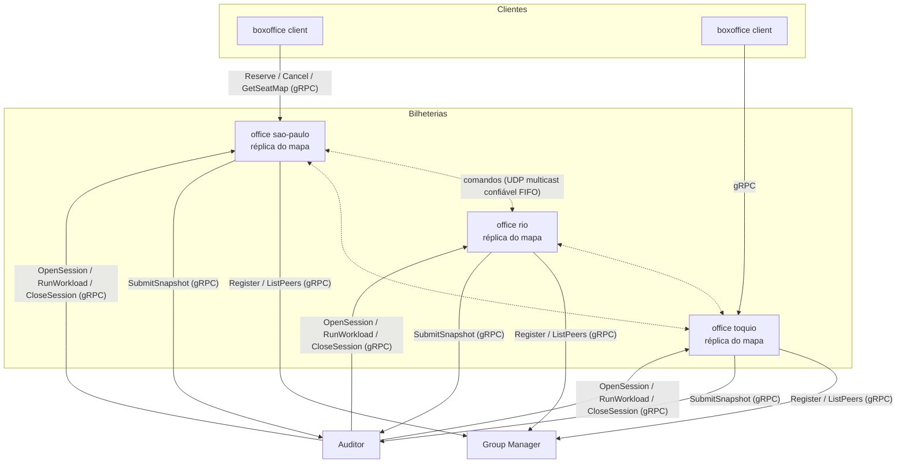
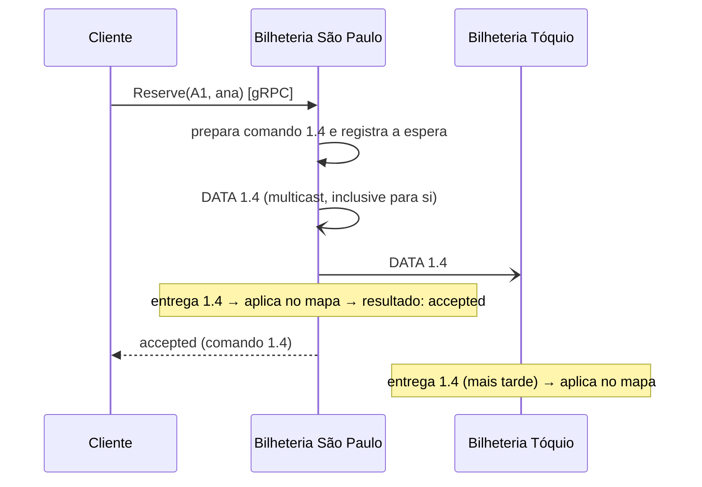

# Bilheterias replicadas – venda de ingressos sobre multicast confiável

[](https://github.com/fernandes-emmanuel/trabalho-final-sd-pt-2/actions/workflows/ci.yml)

Parte 2 do trabalho final de Sistemas Distribuídos. Na [Parte 1](https://github.com/fernandes-emmanuel/trabalho-final-sd-pt-1),
o sistema de comunicação multicast do [MPComm](https://github.com/professorfabio/MPComm) ganhou RPC
e multicast confiável com ordenação FIFO. As mensagens, porém, ainda não tinham significado. Nesta
parte, os processos passam a ser **bilheterias** de um evento e as mensagens passam a ser
**comandos** que alteram uma **base de dados replicada**: o mapa de assentos.

É uma aplicação em que a **ordem das mensagens é crítica**. Quando dois clientes pedem o mesmo
assento em bilheterias diferentes, quem fica com ele depende da ordem em que cada réplica aplica os
pedidos. Se as réplicas aplicarem em ordens diferentes, o mesmo assento é vendido para duas pessoas
(*overbooking*).

## Integrantes – Grupo K

- Emmanuel Fernandes Castro
- Monik Alves da Costa
- Luis Cesar Ferreira do Carmo

## Sumário

1. [A aplicação](#a-aplicação)
2. [Funcionalidades](#funcionalidades)
3. [Arquitetura](#arquitetura)
4. [Detalhes de implementação](#detalhes-de-implementação)
5. [Melhorias no código-base](#melhorias-no-código-base)
6. [Como executar](#como-executar)
7. [Experimentos e resultados](#experimentos-e-resultados)
8. [Por que FIFO não basta](#por-que-fifo-não-basta)
9. [Testes](#testes)
10. [Estrutura do repositório](#estrutura-do-repositório)
11. [Limitações](#limitações)

## A aplicação

Uma produtora vende ingressos de um show em bilheterias espalhadas por várias cidades. Os
requisitos são:

- **qualquer bilheteria vende qualquer assento**, sem consultar uma central, para continuar
  atendendo com baixa latência mesmo longe das outras;
- **todas as bilheterias precisam enxergar o mesmo mapa de assentos**: um assento não pode ser
  vendido duas vezes, e o cliente que recebeu "reserva confirmada" tem que ser o dono do assento
  em todas as bilheterias.

Para isso, cada bilheteria mantém uma **réplica completa** do mapa de assentos. Cada pedido de
cliente vira um comando enviado por **multicast** a todas as bilheterias, inclusive à própria, e
cada réplica aplica os comandos na ordem em que os recebe.

### Por que a ordem importa

O mapa de assentos é uma máquina de estados determinística: aplicar os mesmos comandos na mesma
ordem sempre leva ao mesmo estado. Os comandos, porém, **não comutam**. Um exemplo com dois pedidos
simultâneos pelo assento A1:

| Ordem de aplicação | Resultado de `ana` | Resultado de `bruno` | Dono de A1 |
|---|---|---|---|
| `RESERVE A1 ana` → `RESERVE A1 bruno` | aceito | assento ocupado | ana |
| `RESERVE A1 bruno` → `RESERVE A1 ana` | assento ocupado | aceito | bruno |

Se São Paulo aplicar na primeira ordem e Tóquio na segunda, os dois clientes recebem "aceito", e
cada bilheteria acha que o assento é de uma pessoa diferente. O mesmo vale para:
- um cancelamento seguido de uma nova reserva (ou o contrário);
- uma reserva em grupo, que é tudo ou nada e conflita com qualquer reserva individual de um dos
  assentos.

## Funcionalidades

- **Bilheterias (réplicas)** com o mapa completo de um evento (por padrão, 5 fileiras × 10
  assentos, de A1 a E10).
- **Operações para o cliente**, via gRPC, em qualquer bilheteria:
  - `reserve`: reserva um assento; o primeiro pedido aplicado ganha;
  - `group`: reserva vários assentos, tudo ou nada;
  - `cancel`: cancela uma reserva; só o dono consegue;
  - `map`: mostra o mapa de assentos como aquela bilheteria o enxerga;
  - `race`: dispara pedidos **simultâneos** pelo mesmo assento em várias bilheterias, para
    demonstrar o problema.
- **Sessões de vendas**: o auditor abre a venda em todas as bilheterias, que formam o grupo, e
  depois a encerra. O fechamento é confiável: só termina quando todos os comandos chegaram a todas
  as réplicas.
- **Auditor** (evolução do `comparisonServer`): ao fim de cada sessão, coleta de cada réplica o
  mapa, o *digest* SHA-256 do estado e o log de comandos aplicados, e informa:
  - se todos os comandos chegaram a todas as réplicas;
  - quantos estados distintos existem;
  - quais assentos têm dono divergente e quais foram vendidos a clientes diferentes;
  - quais comandos foram aceitos numa réplica e recusados em outra;
  - a partir de que posição os logs divergem.
- **Carga de trabalho automática** e reprodutível (com *seed*): clientes simulados compram,
  cancelam e reservam em grupo, concentrando parte da demanda em poucos assentos disputados.
- Tudo o que veio da Parte 1: entrega **confiável** (com perda, duplicação e reordenação) e
  **FIFO** por remetente, injeção de falhas, RTO adaptativo e Docker com `tc netem`.

## Arquitetura

O sistema tem duas camadas, que agora são **pacotes separados**:

- [`mpcomm/`](mpcomm): **middleware de comunicação em grupo**, sem nenhum conhecimento da
  aplicação. Oferece sessões de grupo com multicast confiável e FIFO, além de membership.
- [`boxoffice/`](boxoffice): **aplicação de venda de ingressos**. Usa o middleware apenas por meio
  de `GroupSession.multicast(payload)` e de um *callback* de entrega.



| Pacote | Módulo | Responsabilidade |
|---|---|---|
| `boxoffice` | `client.py` | CLI do cliente: reservas, cancelamentos, mapa e corrida |
| | `auditor/` | Abre e fecha sessões, dispara a carga, compara as réplicas |
| | `office/node.py`, `office/services.py` | Processo da bilheteria e serviços gRPC `TicketOffice` e `OfficeControl` |
| | `office/sales.py` | Sessão de vendas: liga a réplica à sessão de grupo |
| | `domain/` | Comandos, mapa de assentos, réplica, gerador de carga (sem rede, sem threads de I/O) |
| `mpcomm` | `group/session.py` | Sessão de comunicação em grupo: barreira de abertura, multicast, fechamento confiável |
| | `transport/reliable.py` | Multicast confiável com FIFO (ACK, retransmissão, *holdback queue*) |
| | `transport/` | Socket UDP, formato das mensagens, injeção de falhas |
| | `membership/`, `rpc/` | Group manager, clientes e servidores gRPC |

As dependências apontam sempre para baixo: `boxoffice.domain` não importa nada de rede, e o
`mpcomm` não importa nada da aplicação. Por isso o mesmo middleware pode receber outro mecanismo de
ordenação (Parte 3) sem que o domínio precise mudar.

## Detalhes de implementação

### Comandos

Os comandos viajam como JSON dentro das mensagens `DATA` do multicast confiável:

```json
{"id": "2.7", "op": "reserve_group", "seats": ["B1", "B2"], "customer": "carla"}
```

| Operação | Regra | Possíveis resultados |
|---|---|---|
| `reserve` | o assento precisa estar livre | `accepted`, `seat_taken`, `unknown_seat` |
| `reserve_group` | **todos** os assentos precisam estar livres (tudo ou nada) | `accepted`, `seat_taken`, `unknown_seat` |
| `cancel` | só o dono atual pode cancelar | `accepted`, `not_owner`, `unknown_seat` |

O identificador `id` é `<bilheteria>.<sequência>`: é único no grupo, sem coordenação, e permite ao
auditor comparar o mesmo comando em todas as réplicas.

### Ciclo de um pedido



A bilheteria **não aplica o comando direto no mapa local**. Ela o envia por multicast ao grupo,
inclusive a si mesma, e só responde ao cliente quando o comando é **entregue e aplicado** pela
própria réplica. Assim, todas as réplicas, inclusive a de origem, aplicam exatamente o fluxo de
comandos entregue pela camada de comunicação. A consistência depende, então, só da **ordem de
entrega**, que é o que as Partes 3 e 4 vão controlar.

### Sessão de vendas

Uma sessão de vendas corresponde a uma `GroupSession` do middleware, que generaliza a "rodada" da
Parte 1:

1. **Abertura:** o auditor chama `OpenSession` em todas as bilheterias. Cada uma consulta o group
   manager para saber quem faz parte do grupo, cria uma réplica vazia do mapa e envia `HELLO` por
   multicast confiável. A venda é liberada quando o `HELLO` de todos foi entregue.
2. **Vendas:** os clientes fazem pedidos em qualquer bilheteria, ou o auditor dispara a carga
   automática (`RunWorkload`).
3. **Fechamento:** o auditor chama `CloseSession`. Cada bilheteria para de aceitar pedidos e envia
   `END` por multicast. Como a entrega é FIFO, receber o `END` de todos garante que **todos os
   comandos da sessão já foram aplicados**. A bilheteria então espera os ACKs pendentes e envia o
   seu *snapshot* ao auditor.

### Auditoria

O auditor compara os *snapshots* com as seguintes métricas:

| Métrica | Como é calculada |
|---|---|
| Comandos em todas as réplicas | Conjunto de `id`s aplicados por réplica (testa a entrega confiável) |
| Estados distintos | Número de *digests* SHA-256 diferentes do mapa |
| Assentos com dono divergente | Assentos cujo dono não é o mesmo em todas as réplicas |
| Overbooking | Assentos com **dois ou mais clientes diferentes** como dono |
| Resultados divergentes | Comandos aceitos numa réplica e recusados em outra (clientes informados de forma inconsistente) |
| Primeira divergência do log | Primeira posição em que a sequência de comandos aplicados difere |

### Contratos gRPC

- [`protos/mpcomm/rpc/membership.proto`](protos/mpcomm/rpc/membership.proto): `GroupManager` (agora
  com o nome de cada membro);
- [`protos/boxoffice/rpc/boxoffice.proto`](protos/boxoffice/rpc/boxoffice.proto): `TicketOffice`
  (clientes), `OfficeControl` (auditor) e `Auditor` (*snapshots*).

Os erros usam códigos gRPC padronizados:
- `FAILED_PRECONDITION`: venda fechada ou sessão repetida;
- `INVALID_ARGUMENT`: comando malformado, como cliente vazio ou assento repetido;
- `UNAVAILABLE`: group manager fora do ar.

## Melhorias no código-base

### Herdadas da Parte 1

| Problema no MPComm original | Situação |
|---|---|
| Comparação de logs com *off-by-one* | Substituída pela auditoria completa das réplicas |
| TCP sem enquadramento e `pickle` vindo da rede | gRPC/Protobuf e JSON |
| Espera ativa e contador global sem sincronização | `Event`/`Condition` |
| Handshake e marcador de fim que travam se um pacote se perder | `HELLO`/`END` confiáveis |
| Perda de mensagens não tratada; nenhuma garantia de ordem | Multicast confiável com FIFO |
| IPs e número de processos fixos no código | Configuração por argumentos/ambiente e grupo dinâmico |

### Novas nesta parte

- **Separação entre middleware e aplicação.** O original misturava, no mesmo arquivo, sockets,
  threads, o experimento e o envio de logs. Agora o `mpcomm` é uma biblioteca de comunicação em
  grupo reutilizável, e o `boxoffice` é uma aplicação que só conhece `multicast` e `deliver`.
- **Sessão de grupo como abstração** (`GroupSession`), com estados explícitos (`CREATED`, `OPEN`,
  `CLOSING`, `CLOSED`). Pedidos fora da janela de vendas são recusados de forma limpa, e a ordem de
  aquisição dos *locks* foi definida para evitar *deadlock* entre a thread de recepção e as
  threads que fazem multicast.
- **Domínio puro e testável:** o mapa de assentos, os comandos e o gerador de carga não dependem de
  rede, e por isso são cobertos por testes unitários rápidos.
- **Membership com nomes:** cada processo se registra com um nome legível (`sao-paulo`, `toquio`…),
  usado nos relatórios e nos logs.
- **Auditor em vez de comparador:** em vez de comparar só a ordem das mensagens, ele compara o
  **estado da aplicação**. Isso separa reordenações inofensivas (comandos que comutam) de
  inconsistências reais.

## Como executar

### Pré-requisitos

- Python 3.11 ou superior
- Docker com Compose, para o cenário geográfico

```bash
python -m venv .venv
source .venv/bin/activate        # Windows: .venv\Scripts\activate
pip install -e ".[dev]"
```

### 1. Sessões automáticas em localhost com um comando

```bash
boxoffice local --offices 5 --sessions 3 --commands 40
boxoffice local --offices 5 --sessions 3 --commands 40 --delay-ms 20 --jitter-ms 20 --loss 0.05 --report results/local.json
```

Sobe o group manager, as bilheterias e o auditor como processos separados, executa as sessões com
carga automática, imprime a auditoria de cada sessão e encerra tudo.

### 2. Uso manual: bilheterias, clientes e auditor em terminais separados

```bash
boxoffice group-manager

boxoffice office --name sao-paulo --advertise-host 127.0.0.1 --udp-port 6789 --control-port 5679
boxoffice office --name rio --advertise-host 127.0.0.1 --udp-port 6790 --control-port 5690

boxoffice auditor --advertise-host 127.0.0.1 --offices 2
```

Com a venda aberta pelo auditor, os clientes podem usar qualquer bilheteria:

```bash
boxoffice client --office 127.0.0.1:5679 reserve A1 --customer ana
boxoffice client --office 127.0.0.1:5690 group B1 B2 B3 --customer bruno
boxoffice client --office 127.0.0.1:5690 cancel A1 --customer bruno     # NOT_OWNER
boxoffice client --office 127.0.0.1:5690 map
boxoffice client race C5 --offices 127.0.0.1:5679 127.0.0.1:5690 --customers carla diego
```

Para encerrar a venda e auditar, pressione Enter no terminal do auditor.

### 3. Bilheterias em vários continentes com Docker

O [`docker-compose.yml`](docker-compose.yml) cria cinco bilheterias:

| Bilheteria | Região | Condição de rede (`tc netem`) |
|---|---|---|
| `sao-paulo`, `rio`, `belo-horizonte` | A | 2 ms ± 1 ms |
| `lisboa`, `toquio` | B | 120 ms ± 60 ms e 5% de perda |

```bash
docker compose up -d --build
docker compose run --rm auditor                       # abre a venda e espera Enter
```

Em outro terminal, com a venda aberta:

```bash
docker compose run --rm client race A1 --offices office-sao-paulo:5679 office-toquio:5679 --customers ana bruno
docker compose run --rm client --office office-lisboa:5679 map
docker compose run --rm client --office office-rio:5679 reserve A2 --customer carla
```

Sessões automáticas e encerramento:

```bash
docker compose run --rm auditor boxoffice auditor --offices 5 --sessions 3 --commands 40 --report results/docker.json
docker compose down
```

### 4. Máquinas reais ou nuvem

Como na Parte 1, nada fica fixo no código:

```bash
boxoffice group-manager
boxoffice office --name lisboa --group-manager <IP_DO_SERVIDOR>:5680 --advertise-host <IP_PUBLICO>
boxoffice auditor --group-manager <IP_DO_SERVIDOR>:5680 --advertise-host <IP_PUBLICO_DO_AUDITOR> --offices 5
boxoffice client --office <IP_DA_BILHETERIA>:5679 map
```

Portas: 5680/TCP (group manager), 5678/TCP (auditor), 5679/TCP e 6789/UDP (bilheterias). As opções
também aceitam variáveis de ambiente com o prefixo `BOXOFFICE_` (`BOXOFFICE_GROUP_MANAGER`,
`BOXOFFICE_OFFICE_NAME`, `BOXOFFICE_ADVERTISE_HOST`…).

## Experimentos e resultados

### Divergência das réplicas em função da latência

O script [`benchmarks/divergence_experiment.py`](benchmarks/divergence_experiment.py) usou 5
bilheterias, 10 sessões por cenário e 40 comandos por bilheteria (200 comandos por sessão). O
atraso e o jitter foram injetados na aplicação, com *seed* fixa.

| Atraso ± jitter (ms) | Sessões completas | Sessões consistentes | Estados distintos (média) | Assentos divergentes | Assentos com overbooking | Resultados divergentes (de 200) |
|---:|---:|---:|---:|---:|---:|---:|
| 0 ± 0 | 10/10 | **10/10** | 1,0 | 0,0 | 0,0 | 0,0 |
| 5 ± 5 | 10/10 | **0/10** | 4,5 | 6,8 | 4,4 | 21,7 |
| 20 ± 20 | 10/10 | **0/10** | 4,7 | 8,6 | 6,5 | 28,3 |
| 60 ± 60 | 10/10 | **0/10** | 5,0 | 14,0 | 10,6 | 44,9 |

- **A entrega confiável funciona em todos os cenários:** todo comando chegou a toda réplica
  ("sessões completas" = 10/10). O problema não é perda de mensagens.
- **Sem latência**, as réplicas terminaram consistentes. Com tudo em localhost, cada comando chega
  a todas as bilheterias antes do próximo pedido concorrente, então a ordem acaba sendo a mesma
  "por sorte".
- **Com apenas 5 ms ± 5 ms**, nenhuma sessão terminou consistente: em média, 4,4 assentos foram
  vendidos a clientes diferentes e cerca de 11% dos clientes receberam respostas que outras
  bilheterias contradizem.
- A divergência **cresce com a distância**. A 60 ms, as 5 réplicas terminam com 5 estados
  diferentes, ou seja, nenhum par de bilheterias concorda sobre o mapa.

### Demonstração com Docker

Corrida pelo assento A1 entre São Paulo (região A) e Tóquio (região B), com a venda aberta:

```text
$ docker compose run --rm client race A1 --offices office-sao-paulo:5679 office-toquio:5679 --customers ana bruno
Simultaneous requests for seat A1:
  ana        at sao-paulo      -> accepted
  bruno      at toquio         -> accepted

Owner of A1 according to each office:
  sao-paulo      -> ana
  toquio         -> bruno
```

Os dois clientes saíram com o ingresso "confirmado" para o mesmo lugar. Em seguida, uma corrida a
três pelo A2 (Rio, Lisboa e Belo Horizonte) e a auditoria ao fechar a venda:

```text
Session 1794949310: 5 offices
id   office          applied  accepted  rejected  retrans  held  digest
-----------------------------------------------------------------------------
0    rio             5        2         3         13       0     0b100e1a1d2b
1    sao-paulo       5        2         3         11       0     fbc372a24315
2    belo-horizonte  5        2         3         12       0     fbc372a24315
3    toquio          5        2         3         3        0     9e4d5c2ff7e6
4    lisboa          5        2         3         1        0     1f90776d5757

Every command reached every replica : OK
Distinct replica states             : 4
Seats with divergent owners         : 2 (2 sold to different customers)
Commands with divergent outcomes    : 5
Replica logs diverge from position  : 0
Replicas consistent                 : NO

Seats with divergent owners:
  A1   rio: ana | sao-paulo: ana | belo-horizonte: ana | toquio: bruno | lisboa: ana
  A2   rio: carla | sao-paulo: elisa | belo-horizonte: elisa | toquio: elisa | lisboa: diego
```

## Por que FIFO não basta

A ordenação FIFO da Parte 1 garante que os comandos **de uma mesma bilheteria** sejam aplicados na
ordem em que ela os emitiu. Isso basta para, por exemplo, uma reserva seguida do cancelamento feito
na mesma bilheteria. O que FIFO **não** garante é a ordem entre comandos de bilheterias diferentes:

- São Paulo aplica o próprio comando imediatamente e o de Tóquio ~120 ms depois;
- Tóquio faz o contrário;
- as duas réplicas recebem exatamente o mesmo conjunto de comandos, mas em ordens diferentes, e a
  máquina de estados leva cada uma a um resultado diferente.

Para a aplicação ser correta, todas as réplicas precisam aplicar os comandos **na mesma ordem
global**. Esse é o requisito de **ordenação total**, implementado na Parte 3. A arquitetura desta
parte já foi pensada para isso: basta trocar a forma como a `GroupSession` entrega as mensagens,
sem alterar o domínio da aplicação.

## Testes

```bash
pytest -v                  # 69 testes, incluindo processos reais
pytest -m "not integration"
ruff check . && ruff format --check .
```

| Arquivo | O que verifica |
|---|---|
| `tests/test_domain.py` | Regras de reserva, cancelamento e grupo; **a ordem de comandos conflitantes muda o estado final**; mesmo log → mesmo *digest*; validação de comandos; réplica e pedidos pendentes; gerador de carga reprodutível |
| `tests/test_audit.py` | Detecção de overbooking, resultados divergentes, comandos faltantes e réplicas ausentes |
| `tests/test_group_session.py` | `GroupSession` sobre UDP real com 20% de perda: abertura, entrega FIFO completa, fechamento, multicast fora da janela |
| `tests/test_offices.py` | Três bilheterias reais: clientes compram via gRPC, as réplicas convergem, códigos de erro, venda fechada |
| `tests/test_integration.py` | Implantação completa em processos separados com perda e atraso |
| `tests/test_reliable.py` e outros | Middleware herdado da Parte 1 (rede simulada determinística, injetor de falhas, mensagens, membership) |

A CI ([`.github/workflows/ci.yml`](.github/workflows/ci.yml)) executa o lint e os testes no Ubuntu
e no Windows, com Python 3.12 e 3.14, e sobe as cinco bilheterias com Docker Compose.

## Estrutura do repositório

```text
├── protos/
│   ├── mpcomm/rpc/membership.proto
│   └── boxoffice/rpc/boxoffice.proto
├── mpcomm/                         middleware de comunicação em grupo
│   ├── group/session.py            sessão de grupo (abertura, multicast, fechamento)
│   ├── transport/                  UDP, mensagens, falhas, multicast confiável FIFO
│   ├── membership/                 group manager
│   └── rpc/                        stubs, clientes e servidor gRPC
├── boxoffice/                      aplicação de venda de ingressos
│   ├── __main__.py                 CLI: group-manager | office | client | auditor | local
│   ├── domain/                     comandos, mapa de assentos, réplica, carga
│   ├── office/                     processo da bilheteria e serviços gRPC
│   ├── auditor/                    auditoria das réplicas
│   ├── client.py                   cliente de linha de comando
│   └── launcher.py                 implantação local
├── benchmarks/divergence_experiment.py
├── tests/
├── Dockerfile, docker-compose.yml, docker/entrypoint.sh
└── .github/workflows/ci.yml
```

## Limitações

- **Esta parte não garante consistência entre réplicas.** É o comportamento esperado e medido
  acima, e o objetivo da Parte 3.
- O estado das réplicas fica em memória e é reiniciado a cada sessão de vendas. Uma bilheteria que
  cai no meio da sessão é detectada (a sessão fica incompleta), mas não há recuperação de estado.
- O group manager continua sendo um ponto único de falha, e os canais gRPC não são cifrados.
